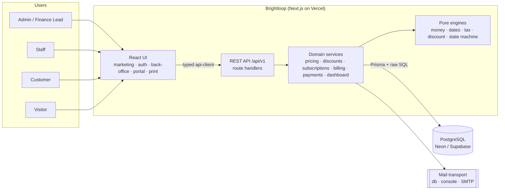
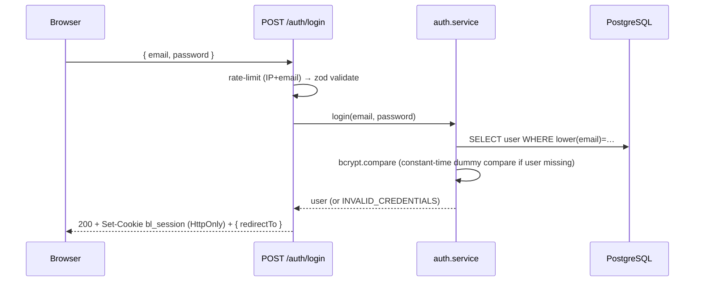
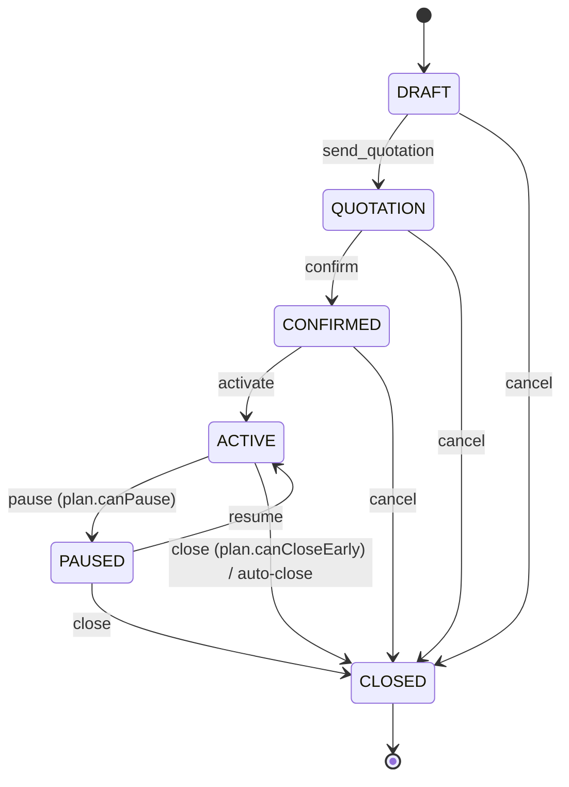
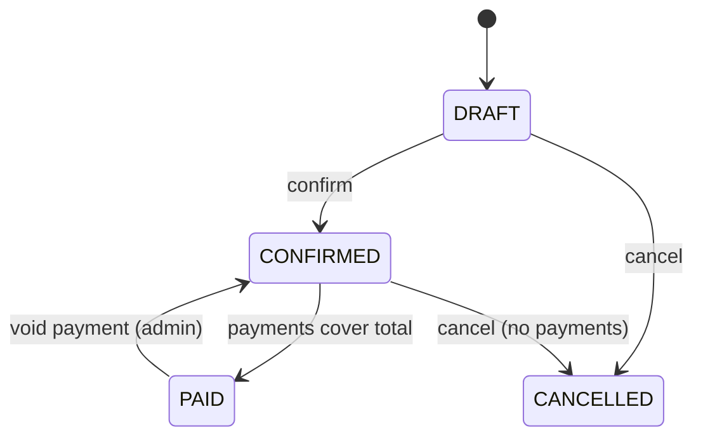
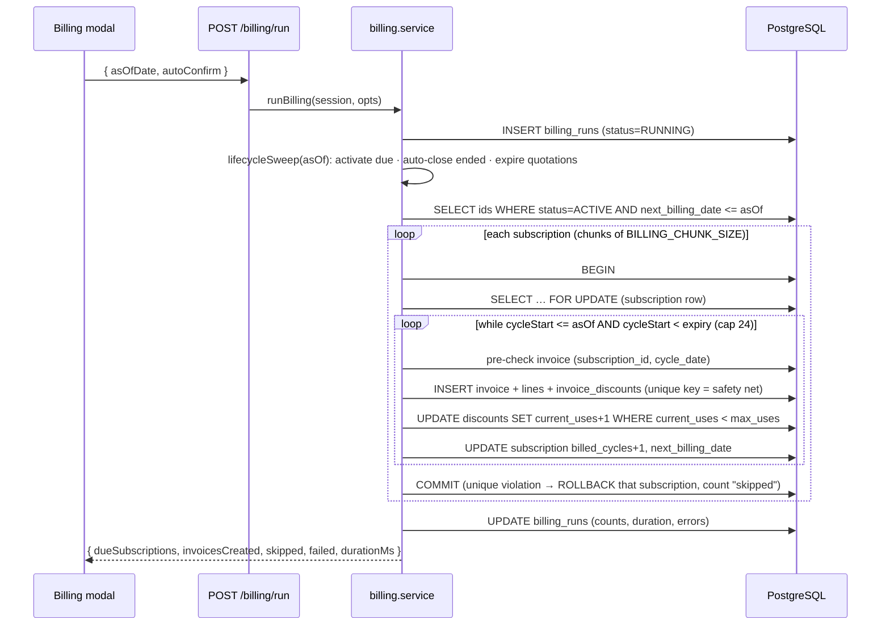

# Brightloop — System Architecture

| | |
|---|---|
| **Version** | 1.0 · 31 Oct 2026 |
| **Style** | Modular monolith (Next.js full-stack) on PostgreSQL |
| **Chosen path** | *Path A* from the blueprint / *Option A* from the tech-stack guide |
| **Related** | [PRD](PRD.md) · [DATABASE](DATABASE.md) · [API](API.md) · [DESIGN](DESIGN.md) · [MEMBERS](MEMBERS.md) |

---

## 1. Architectural Principles

1. **Relational core.** A subscription system is a ledger — strict relations, transactions, SQL aggregates. PostgreSQL only.
2. **Money logic lives in pure functions.** Pricing, tax, discount and date math are side-effect-free modules with unit tests; services call them inside transactions.
3. **The database is the last line of defence.** Uniqueness, check constraints and row locks make double billing impossible even if application code has a bug.
4. **One contract between front and back.** The UI only talks to `/api/v1/*` through a typed client. It never imports from `src/server`. This lets four people work in parallel.
5. **Server decides what is allowed.** Subscription/invoice responses include `allowedActions`; the UI renders buttons from it. No duplicated business rules in React.
6. **Aggregate in SQL, paginate on the server.** No endpoint returns an unbounded list.
7. **Boring tech, fast delivery.** Everything below is mainstream and documented.

---

## 2. Technology Stack (final)

| Layer | Choice | Why |
|---|---|---|
| Framework | **Next.js (App Router) + TypeScript (strict)** | One repo, UI + API, route groups for role areas |
| Styling / UI | **Tailwind CSS + shadcn/ui + lucide-react** | Fast, consistent, matches DESIGN.md |
| Data fetching | **TanStack Query** + typed `api-client` | Caching, loading/error states, invalidation |
| Forms / validation | **react-hook-form + zod** | One zod schema shared by client and server |
| Charts | **Recharts** | Area / bar / donut per DESIGN.md |
| Database | **PostgreSQL** (Neon or Supabase, free tier) | Transactions, `FILTER` aggregates, partial indexes |
| ORM | **Prisma** (+ `$queryRaw` for aggregates) | Readable schema, type-safe queries, migrations |
| Auth | **Custom JWT session** (`jose`) in httpOnly cookie + **bcryptjs** | Full control of RBAC and reset flow; no vendor lock-in |
| Money | **decimal.js** (via Prisma `Decimal`) | No floating-point errors |
| Dates | **date-fns** (+ UTC helpers) | `addMonths` clamps month-ends correctly |
| Email | **Nodemailer** with 3 transports: `db` (default), `console`, `smtp` | Works without any provider; judges can see mails in `/dev/mailbox` |
| Testing | **Vitest** (engines), **Playwright** (smoke, optional), Postman/Thunder collection | Engines are where bugs cost points |
| Seed data | **@faker-js/faker** (seeded) | Reproducible 5,000-subscription dataset |
| Hosting | **Vercel** (app) + **Neon/Supabase** (DB) | Free, one-click, previews per PR |
| CI | **GitHub Actions** | lint · typecheck · test · build on every PR |

> **Prisma note:** generator/datasource configuration changes between Prisma major versions. Follow the install guide for the version you add (`npx prisma init`) and keep `schema.prisma` content from DATABASE.md; only the config wrapper may differ.

---

## 3. System Context



---

## 4. Layered Design

```
HTTP request
   │
   ▼
middleware.ts ──► coarse route guard (cookie present? role allowed for this path prefix?)
   │
   ▼
route handler  (src/app/api/v1/**/route.ts)
   │   wrapped by route({ roles, query?, body? }, handler)  ← M1's helper
   │   = authenticate → authorise → validate (zod) → call service → envelope → map errors
   ▼
service        (src/server/<domain>/*.service.ts)   transactions, orchestration, audit log
   │
   ├──► engine (pure)  (src/server/<domain>/*.engine.ts or src/lib/*)   no I/O, unit-tested
   └──► repository / Prisma client  (src/lib/db.ts)
```

Rules:
- **Route handlers are thin** — no business logic.
- **Services own transactions** (`prisma.$transaction`). Any multi-table write goes through a service.
- **Engines are pure** — input → output; no Prisma, no `Date.now()` (take `today` as a parameter).
- **UI never imports `src/server/**`** (enforced by an ESLint `no-restricted-imports` rule).

### 4.1 The `route()` wrapper (M1 builds it in `T1.03/T1.06`)

```ts
// usage — every API route looks like this
export const POST = route(
  { roles: ['ADMIN', 'STAFF'], body: createSubscriptionSchema },
  async ({ session, body }) => {
    const sub = await subscriptionService.create(session, body);
    return created(sub);               // → { data: sub } with 201
  }
);
```
It guarantees: session loaded, role checked, input validated (`422 VALIDATION_ERROR`), `AppError` mapped to the standard error envelope, `requestId` attached, and unexpected errors logged and returned as `500 INTERNAL_ERROR` without leaking internals.

---

## 5. Repository Structure & Ownership

```
brightloop/
├── docs/                              # PRD, DESIGN, ARCHITECTURE, DATABASE, API, MEMBERS, TODO, LOG
├── prisma/
│   ├── schema.prisma                  # M1 only
│   ├── migrations/                    # M1 only (incl. extras.sql constraints)
│   ├── seed.ts                        # M1: demo users · M4: catalog + volume (separate files below)
│   └── seed/                          # M4: catalog.ts, volume.ts
├── src/
│   ├── middleware.ts                  # M1
│   ├── app/
│   │   ├── layout.tsx, globals.css    # M3
│   │   ├── (marketing)/page.tsx       # M4  landing
│   │   ├── (auth)/                    # M4  login · signup · forgot-password · reset-password
│   │   ├── (app)/                     # Admin/Staff shell — layout.tsx (M3)
│   │   │   ├── dashboard/             # M4
│   │   │   ├── customers/ staff/ taxes/ payment-terms/ settings/ audit-log/ dev/   # M1
│   │   │   ├── products/ plans/ templates/ subscriptions/ invoices/ payments/      # M3
│   │   │   └── discounts/ billing/    # M2
│   │   ├── (portal)/portal/           # M4  customer portal
│   │   ├── print/invoice/[id]/        # M4
│   │   └── api/v1/
│   │       ├── auth/ users/ customers/ products/ variants/ plans/ taxes/ payment-terms/
│   │       │   settings/ audit-logs/ dev/ lookups/ public/ health/               # M1
│   │       ├── templates/ discounts/ subscriptions/ billing/ invoices/ payments/ # M2
│   │       └── dashboard/ reports/ portal/                                       # M4
│   ├── server/                        # server-only code (never imported by UI)
│   │   ├── auth/ rbac/ email/ catalog/ customers/ settings/                      # M1
│   │   ├── pricing/ discounts/ subscriptions/ billing/ payments/ templates/      # M2
│   │   └── dashboard/ portal/ reports/                                           # M4
│   ├── lib/
│   │   ├── db.ts, errors.ts, api-envelope.ts, auth-session.ts                    # M1
│   │   ├── money.ts, dates.ts, sequences.ts, audit.ts, state-machine.ts          # M2
│   │   ├── validators/                # zod schemas — owned by the domain owner
│   │   ├── api-client.ts, format.ts, query-client.ts                             # M3
│   │   └── constants/enums.ts         # M1 (re-exports Prisma enums for the client)
│   ├── components/
│   │   ├── ui/ shared/                # M3
│   │   ├── charts/ dashboard/ marketing/ auth/ print/                            # M4
│   └── features/                      # feature-local UI (hooks, forms) — owner per folder (see DESIGN §14)
├── tests/                             # unit (engines) · e2e
├── .github/ (workflows, CODEOWNERS, PULL_REQUEST_TEMPLATE.md)
├── .env.example
└── README.md                          # M1
```

---

## 6. Authentication & Authorisation

### 6.1 Session
- On login: verify bcrypt hash → issue **JWT (HS256, `jose`)** with `{ sub, role, name, customerId? }`, expiry `SESSION_TTL_HOURS` (default 8).
- Stored in cookie **`bl_session`**: `HttpOnly; Secure (prod); SameSite=Lax; Path=/`.
- `getSession()` reads and verifies the cookie; for sensitive routes it re-checks `users.is_active` so deactivation is immediate.

### 6.2 Defence in depth

| Layer | Check |
|---|---|
| `middleware.ts` | Cookie present; path prefix vs role (`/portal/**` → CUSTOMER; admin-only prefixes → ADMIN; others → ADMIN/STAFF). Redirects to `/login`. |
| `route({ roles })` | Authoritative server-side role check for every API call |
| Service | **Row-level scoping** — customer services always add `where: { customerId: session.customerId }`; a foreign ID returns `404`, not `403` |
| DB | Constraints (unique, check) — never rely on UI alone |

### 6.3 Login sequence


### 6.4 Password reset
`forgot-password` → generate 32 random bytes → store **SHA-256 hash**, `expires_at = now + 30 min` → email link with the raw token → `reset-password` hashes the supplied token, checks not used/expired, updates password, marks token used, **invalidates all other tokens for the user**. The response to `forgot-password` is always `200` with the same text (no account enumeration).

### 6.5 CSRF
`SameSite=Lax` cookie + for every mutating request the route wrapper verifies `Origin`/`Host` match. No state-changing `GET` endpoints.

---

## 7. Domain Engines

### 7.1 Money & dates (`src/lib/money.ts`, `src/lib/dates.ts`)
- All amounts are `Decimal`; helper `round2(x) = x.toDecimalPlaces(2, Decimal.ROUND_HALF_UP)`.
- API transports money as **strings** (`"11114.42"`), UI formats with `formatMoney()` (`Intl.NumberFormat('en-IN')`).
- Business dates are **calendar dates** stored in `DATE` columns. Run the process with `TZ=UTC` and build dates from `YYYY-MM-DD` strings so `addMonths` etc. never shift by timezone. `todayInAppTz()` returns today in `APP_TIMEZONE` (Asia/Kolkata) as a date — passed into services rather than calling `now()` inside engines.
- **Interval math is anchor-based:**
  ```ts
  export function addInterval(anchor: Date, interval: BillingInterval, n: number): Date {
    switch (interval) {
      case 'DAILY':   return addDays(anchor, n);
      case 'WEEKLY':  return addWeeks(anchor, n);
      case 'MONTHLY': return addMonths(anchor, n);   // Jan 31 + 1 → Feb 28; + 2 → Mar 31 (no drift)
      case 'YEARLY':  return addYears(anchor, n);
    }
  }
  export const cycleStart = (sub) => addInterval(sub.billingAnchorDate, sub.plan.billingInterval, sub.billedCycles);
  ```

### 7.2 Pricing & tax (`src/server/pricing`)
```ts
computeLine({ quantity, unitPrice, discountAmount = 0, taxRate }) {
  const amount     = round2(quantity * unitPrice);
  const taxable    = max(0, amount - discountAmount);
  const taxAmount  = round2(taxable * taxRate / 100);
  return { amount, discountAmount, taxable, taxAmount, lineTotal: taxable + taxAmount };
}
computeInvoiceTotals(lines) // sums each column; totals are sums of rounded line values
```

### 7.3 Discount evaluator (`src/server/discounts/discount.engine.ts`)
Pure function — **input:** lines (with productId, gross), candidate discounts (attached + auto-apply), `invoiceDate`; **output:** per-line `discountAmount` + list of `{ discountId, amount }` actually applied.

```
1. filter candidates: isActive ∧ start ≤ date ≤ end ∧ (maxUses = null ∨ currentUses < maxUses)
2. PRODUCT scope:  for each line → candidates whose product list contains line.productId
                   → check thresholds on that discount's eligible lines (Σ gross ≥ minPurchase, Σ qty ≥ minQty)
                   → value = percent ? gross×% : fixed spread proportionally
                   → keep the single largest saving per line
3. SUBSCRIPTION scope: thresholds on invoice gross & total product qty
                   → value on the remaining (post step-2) amount; keep the single largest
                   → allocate across lines proportionally; remainder cents to the last line
4. clamp every line ≥ 0; return applied list
```
Tie-break when savings are equal: earliest `endDate`, then oldest `createdAt`. Ship ≥ 12 unit tests (percent, fixed, thresholds, window edges, exhausted, stacking, rounding remainder, zero-clamp).

### 7.4 Subscription state machine (`src/lib/state-machine.ts`)

```ts
// pure
allowedActions(sub, plan, actorRole, today): Action[]   // used by API responses and by transition guards
assertTransition(sub, plan, actor, action, today)       // throws AppError INVALID_TRANSITION | PLAN_POLICY_VIOLATION | QUOTATION_EXPIRED
```
`allowedActions` is the **single source of truth** — the same function powers the `409` guard and the buttons the UI shows.

### 7.5 Invoice state machine


---

## 8. Billing Engine (the hero feature)

### 8.1 Flow


### 8.2 Reference implementation (M2)
```ts
export async function runBilling(session: Session, opts: { asOfDate: Date; autoConfirm: boolean; subscriptionIds?: string[] }) {
  const t0 = performance.now();
  const run = await prisma.billingRun.create({ data: { asOfDate: opts.asOfDate, autoConfirm: opts.autoConfirm, triggeredById: session.userId, status: 'RUNNING' } });

  await lifecycleSweep(opts.asOfDate);

  const due = await prisma.subscription.findMany({
    where: { status: 'ACTIVE', nextBillingDate: { lte: opts.asOfDate }, ...(opts.subscriptionIds && { id: { in: opts.subscriptionIds } }) },
    select: { id: true }, orderBy: { nextBillingDate: 'asc' },
  });

  const result = { due: due.length, created: 0, skipped: 0, failed: 0, errors: [] as { subscriptionId: string; message: string }[] };

  for (const chunk of chunked(due, env.BILLING_CHUNK_SIZE)) {
    await Promise.all(chunk.map(async ({ id }) => {          // small parallelism; each sub has its own transaction
      try {
        result.created += await billOneSubscription(id, run.id, opts);
      } catch (e) {
        if (isUniqueViolation(e)) result.skipped++;           // another run beat us to it — safe
        else { result.failed++; result.errors.push({ subscriptionId: id, message: toMessage(e) }); }
      }
    }));
  }
  return finishRun(run.id, result, performance.now() - t0);
}

async function billOneSubscription(id: string, runId: string, opts): Promise<number> {
  return prisma.$transaction(async (tx) => {
    await tx.$queryRaw`SELECT id FROM subscriptions WHERE id = ${id}::uuid FOR UPDATE`;   // serialise per subscription
    const sub = await loadForBilling(tx, id);                                              // plan, lines, discount, customer, term
    let created = 0;
    for (let guard = 0; guard < env.BILLING_MAX_CATCHUP_CYCLES; guard++) {
      const start = cycleStart(sub);
      if (sub.status !== 'ACTIVE' || start > opts.asOfDate || start >= sub.expiryDate) break;
      const exists = await tx.invoice.findUnique({ where: { subscriptionId_billingCycleDate: { subscriptionId: id, billingCycleDate: start } } });
      if (!exists) { await createInvoiceForCycle(tx, sub, start, runId, opts.autoConfirm); created++; }
      sub.billedCycles += 1;
    }
    await tx.subscription.update({ where: { id }, data: { billedCycles: sub.billedCycles, nextBillingDate: nextBillingDateOrNull(sub) } });
    return created;
  });
}
```
> **Postgres gotcha:** once a statement errors inside a transaction, the whole transaction is aborted — you cannot "catch and continue". That's why we **pre-check** under the row lock and treat the unique constraint only as a backstop that rolls back that one subscription.

### 8.3 `createInvoiceForCycle` steps
1. Build line snapshots from `subscription_lines` (+ plan-fee line).
2. Load candidate discounts (`sub.discountId` + `autoApply`), run the **discount engine** with `invoiceDate = cycleStart`.
3. For each applied discount: `UPDATE discounts SET current_uses = current_uses + 1 WHERE id = $1 AND (max_uses IS NULL OR current_uses < max_uses) RETURNING id` — **0 rows ⇒ exhausted by a race ⇒ drop it and recompute**.
4. Compute tax per line, totals, `due_date = cycleStart + paymentTerm.days`.
5. Allocate `invoice_number` via atomic sequence; insert invoice (snapshot bill-to name/email/address/GSTIN), lines, `invoice_discounts`.
6. `status = autoConfirm ? CONFIRMED : DRAFT` (`amount_due = total`; zero total + confirm ⇒ `PAID`).
7. Write audit log entry.

### 8.4 Lifecycle sweep (runs at the start of every billing run; also callable via `POST /billing/sweep`, stretch)
- `CONFIRMED` with `startDate ≤ asOf` → `ACTIVE` (sets anchor, `nextBillingDate`).
- `ACTIVE`/`PAUSED` with `plan.autoClose` and (`expiryDate ≤ asOf` or `plan.validTo < asOf`) → `CLOSED` (reason `EXPIRED`/`PLAN_ENDED`).
- `QUOTATION` past `validUntil` → flagged expired (derived; no status change).

### 8.5 Pause / resume maths
`resume`: `pausedDays = diffInCalendarDays(today, pausedAt)`; `billingAnchorDate += pausedDays`; `expiryDate += pausedDays`; `nextBillingDate = cycleStart(sub)`; `pausedAt = null`. *Pause freezes the clock.*

### 8.6 Payment settlement (`payments.service.record`)
Single transaction: lock invoice row (`FOR UPDATE`) → validate `status = CONFIRMED`, `0 < amount ≤ amount_due` → insert payment → `amount_paid += amount`, `amount_due = total − amount_paid` → if `amount_due = 0` then `status = PAID`, `paidAt` → audit log. Void reverses the same fields and returns status to `CONFIRMED`.

---

## 9. Performance Architecture (the < 2 s SLA)

| Technique | Detail |
|---|---|
| **Indexes** | Defined in DATABASE.md: `subscriptions(status)`, `(status, next_billing_date)`, `invoices(status, due_date)`, partial `idx_invoices_overdue`, `invoices(customer_id)`, `invoices(invoice_date)`, `payments(payment_date)` |
| **SQL aggregates** | KPIs via one `SELECT … FILTER (WHERE …)` per widget group — never summed in Node |
| **Pagination** | Default 25, max 100; `LIMIT/OFFSET` (cursor optional for infinite lists) |
| **Selective columns** | List endpoints `select` only displayed fields; no `include` of whole trees |
| **No N+1** | Join or batched `IN` queries; list screens fetch related names in the same query |
| **Parallel widgets** | Dashboard endpoints are independent; the page fires them in parallel (`Promise.all` / separate queries) |
| **Short cache** | Dashboard summary cached 30 s per filter key (in-memory/`unstable_cache`) — optional |
| **Pooling** | Use the provider's *pooled* connection string for `DATABASE_URL`, direct URL only for migrations |
| **Warm-up** | Ping `/api/v1/health` (which runs `SELECT 1`) before the demo to avoid cold-start latency |

**Budgets**

| Operation | Target (p95) | Hard limit |
|---|---|---|
| Dashboard summary API | < 300 ms | 2 s page |
| Each paginated list API (5k–20k rows) | < 300 ms | 2 s page |
| Billing run, 500 due subscriptions | < 10 s | — |
| Single invoice detail | < 150 ms | — |

**Verification (task `T6.02`):** seed with `SEED_VOLUME=5000`, run `EXPLAIN (ANALYZE, BUFFERS)` on each dashboard query, load every page with the browser Network tab (throttle off and "Fast 3G"), record results in LOG.md §9.

---

## 10. Security

| Area | Measure |
|---|---|
| Passwords | bcrypt cost 12; policy regex shared client/server; never logged or returned |
| Reset tokens | 256-bit random, stored as SHA-256, 30-min expiry, single use |
| Sessions | httpOnly, Secure, SameSite=Lax JWT; short TTL; deactivation honoured immediately |
| Input | zod on **every** body/query/param; Prisma parameterised queries; raw SQL uses tagged templates only |
| Authorisation | Role check in wrapper **and** row scoping in services; IDs from URL are never trusted |
| Rate limiting | Login 5/min per IP+email; forgot-password 3/min; in-memory limiter (documented caveat: per-instance on serverless) |
| Headers | `Content-Security-Policy`, `X-Frame-Options: DENY`, `X-Content-Type-Options: nosniff`, `Referrer-Policy`, `Strict-Transport-Security` via `next.config` |
| Secrets | `.env` git-ignored; `.env.example` has placeholders only; production secrets in Vercel env; **never** commit connection strings |
| Errors | Generic messages to clients; details only in server logs with `requestId` |
| Audit | Every state change (subscription, invoice, payment, discount, user) writes `audit_logs` |
| Dev tools | `/dev/mailbox` and seed endpoints disabled when `NODE_ENV=production` unless `ENABLE_DEV_MAILBOX=true` |

---

## 11. Email

`email.service.send({ to, template, data })` renders HTML templates (reset password, invoice, quotation) and delegates to a transport chosen by `EMAIL_TRANSPORT`:

| Transport | Behaviour | Use |
|---|---|---|
| `db` *(default)* | Stores the rendered mail in `email_logs` → visible at `/dev/mailbox` | Demo / judging with no SMTP |
| `console` | Prints to server log | Local dev |
| `smtp` | Nodemailer with `SMTP_*` | If a provider is available |

Every send writes an `email_logs` row (`SENT`/`FAILED`) regardless of transport.

---

## 12. Printing / PDF
`/print/invoice/[id]` renders a print-optimised HTML page (A4 CSS, `print:hidden` chrome). **Print / Save as PDF** calls `window.print()`. Server-side PDF (e.g. `@react-pdf/renderer`) is a P2 stretch.

---

## 13. Error Handling & Logging

- **Error classes** (`src/lib/errors.ts`): `AppError(code, status, message, details?)` with subclasses `ValidationError`, `UnauthenticatedError`, `ForbiddenError`, `NotFoundError`, `ConflictError`, `InvalidTransitionError`, `PolicyViolationError`.
- **Envelope:**
  ```json
  { "error": { "code": "INVALID_TRANSITION", "message": "Cannot move from DRAFT to ACTIVE.", "details": { "from": "DRAFT", "action": "activate" }, "requestId": "req_8f2c…" } }
  ```
- **Client:** `api-client` throws a typed `ApiError`; TanStack Query shows toast for mutations and inline error card for queries.
- **Server logs:** one JSON line per request (`requestId`, method, path, status, ms, userId) + error stack for 5xx.
- **Business log:** `audit_logs` (who/what/when) and `billing_runs` (per run results).

---

## 14. Environments & Deployment

| Env | App | Database | Notes |
|---|---|---|---|
| Local (each dev) | `npm run dev` | Personal **Neon branch** (or local Postgres) | Own `.env.local` |
| Preview | Vercel preview per PR | Shared *preview* branch DB | Seed demo data |
| Production (demo) | Vercel prod from `main` | Neon `main` branch | Seeded with 5,000 subs; warm-up before demo |

**Scripts (`package.json`):** `dev`, `build`, `lint`, `typecheck`, `test`, `db:migrate` (`prisma migrate dev`), `db:deploy` (`prisma migrate deploy`), `db:seed` (demo + catalog), `db:seed:volume`, `db:reset` (dev only).

**CI (GitHub Actions):** install → `prisma generate` → lint → typecheck → unit tests → build. PRs cannot merge on red CI.

---

## 15. Testing Strategy

| Level | Scope | Tooling | Owner |
|---|---|---|---|
| Unit | money, dates (29/30/31, leap year), tax, discount engine, state machine, password regex | Vitest | M2 (+ M1 for password) |
| Integration | billing engine (double run, catch-up, concurrency ×2, pause, expiry, exhausted discount), payments (partial, exact, over, void) against a test DB | Vitest + test DB | M2 |
| API / RBAC | Every route × role matrix returns the expected status | Vitest/Supertest-style or Postman | M1 |
| E2E smoke (optional) | Signup → login → create subscription → billing → pay | Playwright | M4 |
| Performance | Dashboard + lists with seeded volume | Browser + `EXPLAIN` | M4 |

**Minimum must-pass suite before freeze:** idempotency, catch-up, month-end, discount exhaustion, tax rounding example (§8.11 of PRD = `11,114.42`), password policy, RBAC matrix.

---

## 16. Key Decisions (summary — full log in LOG.md §3)

| # | Decision | Rationale |
|---|---|---|
| D-001 | Path A web app, not a native Odoo module | Fits team skills, full UI control |
| D-003 | Modular monolith in Next.js | One repo, no CORS, fastest for 4 juniors |
| D-004 | Custom JWT auth, not a hosted provider | Exact RBAC + reset behaviour; no external dependency during judging |
| D-007 | Plan price = automatic *plan fee* line | Keeps "what the plan costs" explicit without breaking line-based billing |
| D-009 | Idempotency by unique key + row lock + pre-check | Satisfies "never twice, never skipped" even under concurrency |
| D-010 | Anchor-based cycle dates | Prevents month-end drift |
| D-013 | `PAUSED` as a real status | Billing query stays a simple `status = 'ACTIVE'` |

---

## 17. Future Extensions (out of scope for v1)
Proration & mid-cycle upgrades · usage-based billing · real gateway webhooks (Razorpay/Stripe test mode) · dunning schedule & reminder emails · multi-currency · accounting export · background job runner (cron/queue) replacing the manual Billing Day button.
